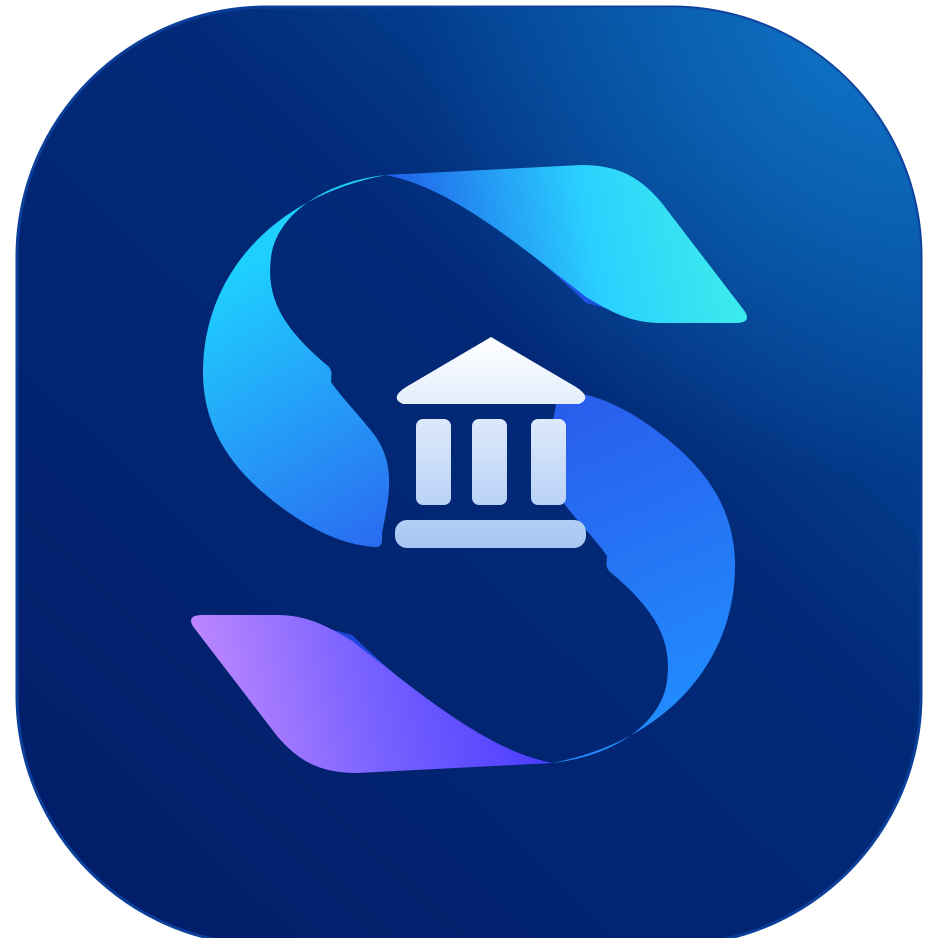

<p align="center">
  
</p>

<h1 align="center">Saral Banking</h1>

<p align="center">
  <strong>Accessible · Predictable · Multilingual Digital Banking for Bharat</strong>
</p>

<p align="center">
  
  
  
  
  
  
  
</p>

<p align="center">
  <em>Built for the GEC Jammu Hackathon — A standardized, jargon-free, mobile-first banking prototype<br/>designed so that every citizen, regardless of age, language, or digital literacy, can bank confidently.</em>
</p>

---

## 📋 Table of Contents

- [The Problem](#-the-problem)
- [Our Solution — The Saral Standard](#-our-solution--the-saral-standard)
- [Demo Accounts](#-demo-accounts)
- [Features](#-features)
- [Tech Stack](#-tech-stack)
- [Quick Start](#-quick-start)
- [Deployment](#-deployment)
- [Project Structure](#-project-structure)
- [Safety & Security](#-safety--security)
- [Accessibility](#-accessibility)
- [Test Suite](#-test-suite)
- [Team](#-team)

---

## 🎯 The Problem

> *"Every bank app looks different. Every update moves the buttons. My father can't find his balance. My grandmother is afraid to press Send."*

India has **300+ million** digital banking users, yet:

- Every bank designs its own layout — users relearn everything when switching banks.
- Jargon like "NEFT", "Beneficiary", "IMPS" confuses first-time digital users.
- Elderly users, rural citizens, and minors are left behind by complex interfaces.
- No standardization exists across institutions for placement, language, or safety flows.

---

## 💡 Our Solution — The Saral Standard

**Saral Banking** implements a **Universal Banking Standard** — a fixed, predictable UI contract that works identically across every bank. Switch from Saral Bank → Janata Bank → Desh Bank, and only the brand colours change. Every button, every flow, every word stays the same.

### The 5 Pillars

| # | Pillar | What It Means |
|---|--------|---------------|
| 1 | **Same 5 tabs everywhere** | Home · Accounts · Cards · History · Services |
| 2 | **Same place for the same thing** | Balance always at top; primary action always at bottom |
| 3 | **Same words** | "Send money" not "Fund transfer". Tap any dotted term → plain-language explanation |
| 4 | **Same 3-step flow** | Fill in → Review → Confirm with PIN. Every single action. |
| 5 | **Bank switcher = colours only** | Saral 🔵 · Janata 🟢 · Desh 🟣 — layout never changes |

---

## 👤 Demo Accounts

All accounts use **Demo PIN: `1234`**

| Profile | Age | Mode | Default Language | Description |
|---------|-----|------|-----------------|-------------|
| **Shankar Prasad** | 68 | 🟢 Simple | Hindi 🇮🇳 | Retired pensioner. Large buttons, simplified menus, auto read-aloud in Hindi & Tamil |
| **Priya Sharma** | 32 | 🔵 Standard | English 🇬🇧 | Working professional. Full-featured standard banking with salary, rent, shopping |
| **Aarav Mehta** | 15 | 🟡 Young Saver | English 🇬🇧 | Minor account with savings goals, spending limits, and guardian (Mom: Priya) approval |

---

## ✨ Features

### 🏦 Core Banking
- **Home Dashboard** — Greeting, balance (show/hide), recent transactions, quick actions
- **Send Money** — UPI payments with payee selection, amount entry, review, and PIN confirmation
- **Transaction History** — Grouped by day, tap for full details with decoded raw bank descriptions
- **Statements** — 1/3/6-month or custom date range, CSV export, print-friendly view
- **Accounts** — Multi-account overview with masked account numbers
- **Cards Management** — View virtual card, block/unblock, manage daily limits

### 🔐 Security & Safety
- **4-Digit PIN Authentication** with SHA-256 hashing (pure JS fallback for mobile HTTP)
- **Biometric Fingerprint Unlock** — WebAuthn enrollment + simulated fallback for demo devices
- **New Payee Safety Guard** — 24-hour cooling period with ₹10,000 limit
- **Large Payment Warnings** — "Did someone ask you to send this?" for amounts > ₹10,000
- **Emergency Fraud Block** — 1-tap card & UPI block with direct links to **1930 Helpline** & **cybercrime.gov.in**
- **Auto-Lock** — 120 seconds idle → automatic sign-out
- **3 Wrong PINs** → 30-second lockout with countdown

### 🌍 Trilingual Support (EN · HI · TA)
- **355+ translation keys** across English, Hindi, and Tamil
- **Tamil Sandhi Numbering** — Proper ஆயிரம் (thousand), இலட்சம் (lakh), கோடி (crore) with grammatical joins
- **Read Aloud** — Web Speech API reads balances, buttons, and transaction details in all 3 languages
- **Auto Language Detection** — Shankar defaults to Hindi; switch to Tamil and hear spoken confirmation

### 🤖 AI-Powered Help
- **Gemini-Powered Chat Assistant** — Context-aware answers about banking, transactions, and services
- **Keyword Fallback** — Works offline with built-in multilingual FAQ matching
- **Sensitive Data Masking** — PINs, OTPs, and account numbers auto-redacted in chat
- **"Ask About This"** — Tap any transaction → get a plain-language explanation

### 🎯 Specialized Modes
- **Simple Mode (Elderly)** — 4 large buttons, high contrast option, bigger text, voice-first
- **Young Saver Mode (Minors)** — Savings goals with progress bars, guardian approval for payments > ₹5,000, daily spending limits, pocket money requests
- **Standard Mode** — Full-featured banking for everyday users

### 📱 Additional Features
- **QR Code Scanner** — Camera-based UPI QR scanning with strict payment-only validation
- **Voice Control** — Speech recognition for hands-free navigation
- **Bank Switcher** — Toggle between 3 bank themes (Saral, Janata, Desh) — only colours change
- **Payment Receipts** — Download & share payment proof with UPI reference
- **Text Size** — 3-step adjustment (Normal → Large → Largest)
- **High Contrast Mode** — Enhanced visibility for low-vision users
- **Learn & Scam Education** — Interactive lessons on UPI safety, common scam patterns
- **Demo Reset** — One-tap reset to restore all demo data

---

## 🛠️ Tech Stack

| Layer | Technology | Purpose |
|-------|-----------|---------|
| **Frontend** | React 19.3 + Vite 8.3 | SPA with HMR, client-side routing |
| **Styling** | Tailwind CSS 4.3 + CSS Variables | Design tokens, bank theming, responsive |
| **Routing** | React Router 7.18 | Client-side navigation with 20+ routes |
| **Backend** | Express 5.3 | AI chat API, serverless on Vercel |
| **AI** | Google Gemini 3.5 Flash | Contextual chat assistant |
| **Auth** | Web Crypto API + SHA-256 | PIN hashing with pure-JS fallback |
| **Biometrics** | WebAuthn / FIDO2 | Fingerprint enrollment & unlock |
| **Speech** | Web Speech API | Text-to-speech (3 languages) + voice recognition |
| **Deploy** | Vercel | Frontend SSG + Express serverless functions |
| **Testing** | Custom Node.js test suite | 37 automated specification checks |

---

## 🚀 Quick Start

### Prerequisites
- **Node.js** 18+ and **npm**

### 1. Clone & Install
```bash
git clone https://github.com/Saumya2509/saral-banking.git
cd saral-banking
npm install
```

### 2. Run Development Server
```bash
npm run dev
```
Open **http://localhost:3000** → Splash screen → Sign in with PIN **`1234`**

### 3. Run Express API (Optional — for AI Chat)
```bash
# Create a .env file with your Gemini API key
echo "GEMINI_API_KEY=your_key_here" > .env

# Start the API server
npm run server
```

### 4. Build for Production
```bash
npm run build
```

---

## 🌐 Deployment

### Vercel (Recommended)

The project is pre-configured with `vercel.json` for zero-config deployment:

1. Push to GitHub
2. Import on [vercel.com/new](https://vercel.com/new)
3. Add environment variable: `GEMINI_API_KEY` = your API key
4. Click **Deploy**

Both the Vite frontend and Express API (`/api/chat`) deploy automatically.

**Live URL:** Deployed on Vercel

---

## 📁 Project Structure

```
saral-banking/
├── api/                    # Vercel serverless entry point
│   └── index.js            # Express app export for /api/* routes
├── biometric/              # WebAuthn fingerprint engine
│   ├── biometric.js        # Core enrollment, unlock, capability detection
│   ├── biometricStore.js   # localStorage credential persistence
│   └── BiometricEnrollModal.jsx  # Post-PIN enrollment prompt
├── server/                 # Express backend
│   ├── express.js          # API server (chat endpoint, health check)
│   ├── chatCore.js         # Gemini integration with masking & validation
│   └── systemPrompt.js     # AI system prompt with banking knowledge
├── shared/                 # Shared utilities (client + server)
│   └── mask.js             # PIN, OTP, account number masking
├── scripts/                # Automated test suite
│   ├── test-biometric.js   # 6 biometric specification tests
│   ├── test-voice.js       # 16 voice & chat specification tests
│   ├── check-i18n.mjs      # i18n completeness validator (355+ keys × 3 langs)
│   └── verify-all.js       # 37-point full audit suite
├── src/
│   ├── components/
│   │   ├── shell/          # AppShell, Header, Screen, TabBar
│   │   ├── ui/             # Card, BigButton, Amount, Sheet, ReadAloud, QrScanner...
│   │   ├── voice/          # VoiceControl with speech recognition
│   │   └── icons/          # SVG icon components
│   ├── screens/            # 15 screen modules (20+ routes)
│   │   ├── home/           # Dashboard with balance, quick actions
│   │   ├── signin/         # PIN pad, biometric unlock, persona selector
│   │   ├── splash/         # Animated intro screen
│   │   ├── pay/            # SendMoney, PayAmount, PayReview, PayReceipt
│   │   ├── history/        # Transaction list, detail view
│   │   ├── statements/     # Date range filter, CSV export, print view
│   │   ├── services/       # Cheque, card block, limits, nominee
│   │   ├── cards/          # Virtual card, block/unblock
│   │   ├── learn/          # Educational lessons, scam awareness
│   │   ├── help/           # AI chat, fraud reporting
│   │   ├── settings/       # Text size, contrast, language, biometric toggle
│   │   ├── young/          # Savings goals, guardian consent & view
│   │   └── ...             # Accounts, Profile, Standard, Payees
│   ├── data/               # Demo data (customers, transactions, banks, payees)
│   ├── i18n/               # Trilingual translation engine (EN, HI, TA)
│   ├── store/              # React context + reducer (session, settings, pay, young)
│   ├── utils/              # Money formatting, speech, audio, dates, ledger, chat
│   └── auth.js             # PIN hashing with SHA-256 + pure-JS fallback
├── public/                 # Static assets (salar.svg, favicon, icons)
├── vercel.json             # Vercel deployment configuration
├── vite.config.js          # Vite build config with Gemini key injection
└── package.json            # Dependencies and scripts
```

---

## 🛡️ Safety & Security

| Feature | Implementation |
|---------|---------------|
| **PIN Hashing** | SHA-256 via Web Crypto API with pure-JS fallback for mobile LAN HTTP |
| **Biometric Auth** | WebAuthn/FIDO2 platform authenticator with simulated fallback |
| **Sensitive Data Masking** | Auto-redacts 4-digit PINs, 6-digit OTPs, 10+ digit account numbers |
| **Payment Safety** | ₹10K+ warning prompt, new payee 24hr cooling, "did someone ask you?" |
| **Emergency Block** | 1-tap card + UPI freeze with 1930 Helpline & cybercrime.gov.in |
| **Auto-Lock** | 120s idle → auto sign-out, 3 wrong PINs → 30s lockout |
| **No .env in Git** | API keys purged from entire git history; `.gitignore` protects all env files |
| **QR Validation** | Strict `upi://pay?` prefix enforcement — rejects non-payment QR codes |

---

## ♿ Accessibility

- **WCAG AA** compliant colour contrast ratios
- **3-step text scaling** (16px → 20px → 24px base)
- **High contrast mode** toggle in settings
- **Read Aloud** for balances, buttons, and transaction details in 3 languages
- **Voice control** — speak to navigate
- **Keyboard navigation** — PIN pad supports physical keyboard input
- **Semantic HTML** with ARIA labels
- **Simple Mode** for elderly users — larger touch targets, fewer options, spoken confirmation

---

## 🧪 Test Suite

```bash
# Run all tests
npm test

# Individual test suites
node scripts/test-biometric.js    # 6 WebAuthn specification tests
node scripts/test-voice.js        # 16 voice, chat & QR validation tests
node scripts/check-i18n.mjs       # i18n completeness (355+ keys × 3 languages)
node scripts/verify-all.js        # 37-point full specification audit
```

**Current Status: ✅ 37/37 checks passing**

```
✓ Safety & Privacy (3)      ✓ The Standard (3)       ✓ Bank Switcher (1)
✓ Customers & Modes (3)     ✓ Young Saver (3)        ✓ Home (2)
✓ Pay & Safety (4)          ✓ History (3)            ✓ Statements (3)
✓ Services (2)              ✓ Learn & Help (4)       ✓ Settings (2)
✓ Money & Data (1)          ✓ Voice Control (1)      ✓ Languages (1)
✓ Biometric Auth (1)
```

---

## 📊 Project Stats

| Metric | Value |
|--------|-------|
| React Components | 67 |
| Source Files | 134 |
| Lines of Code | 22,400+ |
| Translation Keys | 355+ (× 3 languages) |
| Demo Transactions | 200+ |
| Routes | 20+ |
| Automated Tests | 37 specification checks |

---

## 👥 Team

Built with ❤️ for the **GEC Jammu Hackathon**

---

<p align="center">
  <strong>Saral Banking</strong> — Simple Banking. Better Tomorrow.<br/>
  <em>सरल बैंकिंग · எளிமையான வங்கி</em>
</p>
